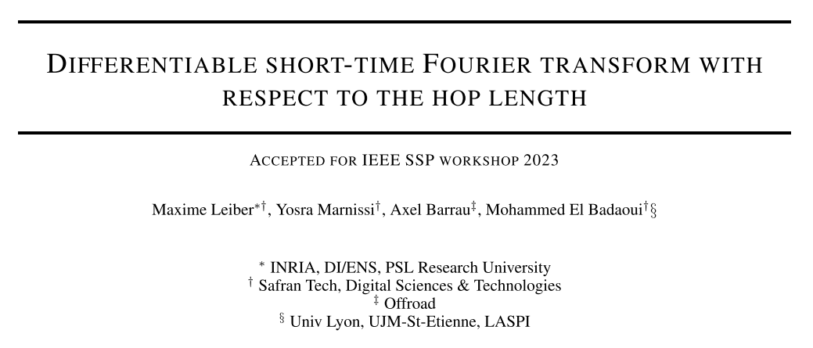
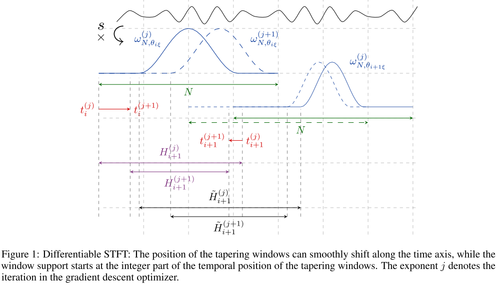
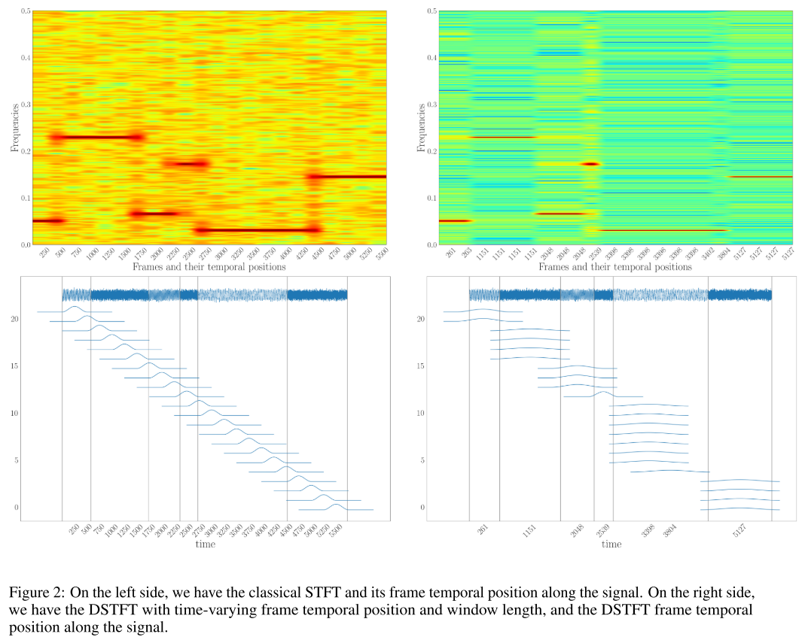

# Time-Frequency Analysis: Estimate of Jump Length in Differentiable Short-Time Fourier Transform [Link to Code]

In this paper, we propose a differentiable version of Short-Time Fourier Transform (STFT), which allows for gradient-based optimization of parameters by continuously varying the hop length or frame time position. Our method provides improved control over frame time localization due to the continuous nature of the hop length, allowing for finer adjustments in optimization. Additionally, our contribution enables the use of optimization methods such as gradient descent, which is more efficient than traditional discrete optimization methods. Our differentiable STFT can also be easily integrated into existing algorithms and neural networks. We present a simulation to demonstrate the effectiveness of our method and have gained interest from the research community.
Introduction: The Short-Time Fourier Transform (STFT) is a commonly used tool for analyzing non-stationary digital signals across various domains, including audio [Stafford et al., 1998], medical [Huang et al., 2019], and vibration analysis [Leclère et al., 2016]. Spectral plots obtained from STFT magnitude are crucial for visualization, understanding, and processing of non-stationary signals in time-frequency representations.
STFT parameters, including the conical function, window length, and hop size, are crucial and depend on the application and signal characteristics. The conical function balances frequency resolution with spectral leakage; narrower main lobes provide better frequency resolution at the expense of increased spectral leakage, while wider main lobes reduce spectral leakage but decrease frequency resolution. Hann or Hamming windows are a common starting point, but the optimal choice depends on the specific requirements of the application. In fact, most research on STFT parameters focuses on the selection of window length, as it determines the trade-off between time and frequency resolution. Shorter window lengths provide better time resolution but worse frequency resolution. Conversely, longer window lengths provide better frequency resolution but poorer time resolution. To fine-tune time and frequency resolution based on the local characteristics of the input signal, researchers have proposed using variable-length windows. These methods are known as S transforms (Stockwell et al. [1996], Sejdi'c et al. [2007], Moukadem et al. [2015], Adaptive STFT by Czerwinski and Jones [1997], Kwok and Jones [2000], Zhong and Huang [2010], Pei and Huang [2012], Zhu et al. [2015]). Typically, the best window length is selected in the 2D plane to support sparsity according to specific criteria such as Zhao et al. [2021], Jablonski and Dziedziech [2022], Pei and Huang [2012], Meignen et al. [2020]. Since these parameters are discrete, grid search or trial-and-error methods are typically used to find the optimal tuning, which can be time-consuming. Recently, Zhao proposed a different version of STFT that allows for differentiation, among others [2021], Leiber et al. [2022 a, B, 2023] made window length a continuous parameter that can be optimized through gradient descent.
The third parameter in STFT, the hop length, controls the trade-off between temporal resolution and computational cost. The smaller the hop length, the higher the temporal resolution, allowing for more detailed changes in frequency content over time. Conversely, larger hop lengths provide lower temporal resolution, which may be sufficient in applications such as music classification by Choi et al. [2017] and sound event detection by Parascandolo et al. [2016], where the focus is on identifying the presence of certain sound events rather than their exact time positions. Additionally, in machine learning applications, the choice of hop length significantly impacts model performance, as shorter hop lengths provide more detailed information about the data but increase computational complexity. It is important to note that accurate recognition and localization of transient events are crucial in many applications, such as bird song classification by Achevedo et al. [2009], Koh et al. [2019], and vibration health monitoring tasks like shock characterization and angular position detection of harmonic sources by Sadler et al. [1998], Chandra and Sekhar [2016]. Capturing the fine temporal structure of these events can provide valuable insights and enable reliable analysis and diagnosis. However, accurate localization of these events can be challenging if the analysis window does not align with the start of the target component, leading to energy leakage in the spectral plot. Therefore, selecting an appropriate hop length is critical for capturing the signal's temporal dynamic characteristics (e.g., attack and decay of the target component).
In summary, the optimal hop length value in the spectral plot depends on the specific application and input signal characteristics. To our knowledge, due to most applications using fixed hop lengths, there has been insufficient research to adjust or optimize hop lengths to suit signal characteristics. These fixed hop lengths are typically set as default values in commonly used signal processing libraries or selected empirically through trial and error.
Our main contribution in this paper is the development of a differentiable version of STFT, which allows for the easy optimization of jump lengths (or frame indices) per frame using gradient descent. This is achieved by modifying the definition of the STFT operator to make the jump lengths continuous parameters, allowing STFT values to be distinguished relative to that continuous parameter. We leverage the continuity of cone functions to distinguish frames temporally. The STFT operation is mathematically differentiable, and we provide necessary calculations and formulas for propagation and backpropagation.
Article illustrations
Conclusion: In summary, we have introduced a novel modification of DSTFT that makes the operation distinguishable with respect to jump length or frame time position. Through an example, we demonstrate the benefits of using our differentiable STFT. Our proposed method provides improved control over frame temporal localization, and enables the use of computationally more efficient optimization methods such as gradient descent. Our differentiable STFT can also be easily integrated into existing algorithms and neural networks.
End

## Images

<!-- PAYMENT_BLOCK -->

## Get this dataset

- Payment link (Stripe): [Buy now](https://buy.stripe.com/3cs8yP7sY87d0vu9AB)
- Payment QR code: 

<!-- /PAYMENT_BLOCK -->
